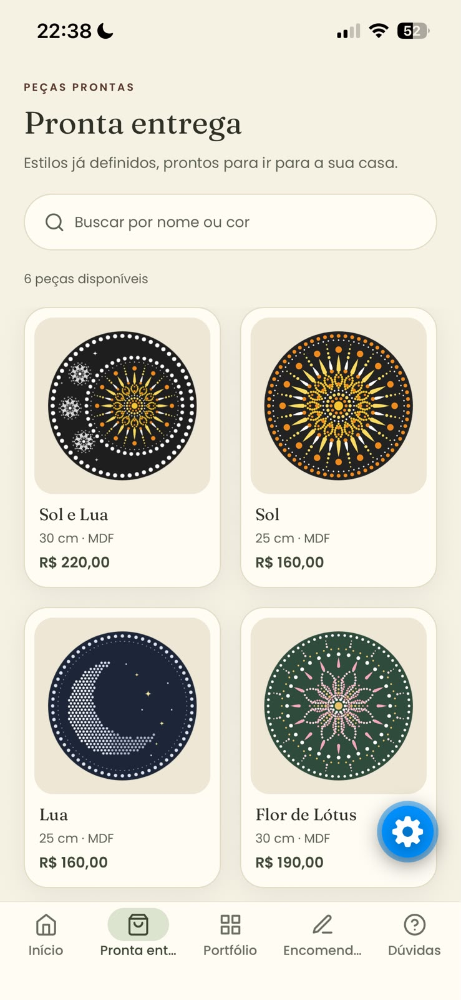
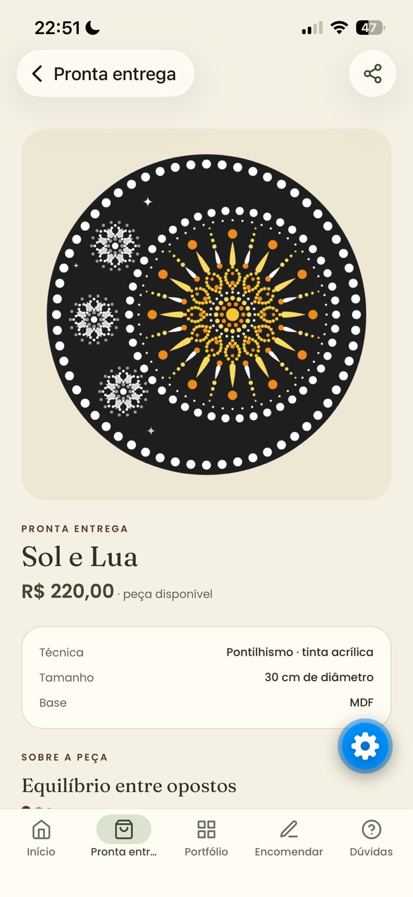
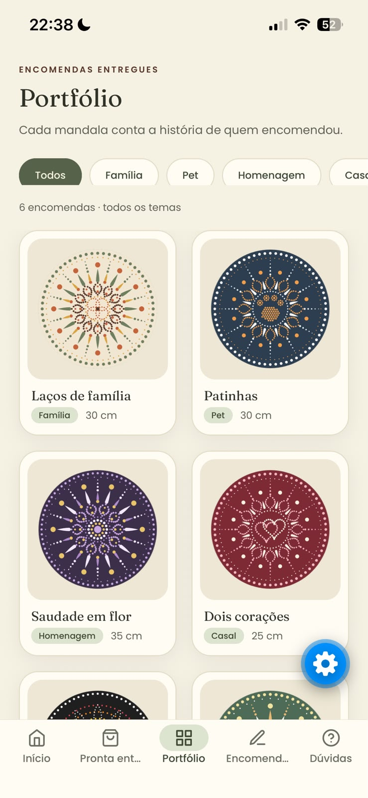
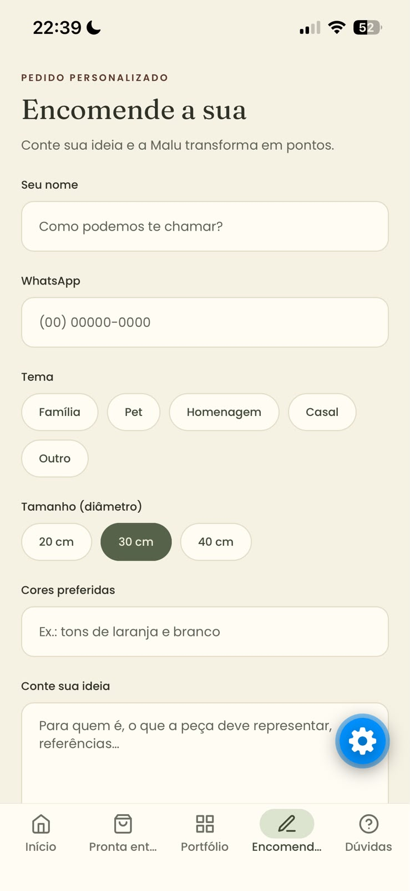
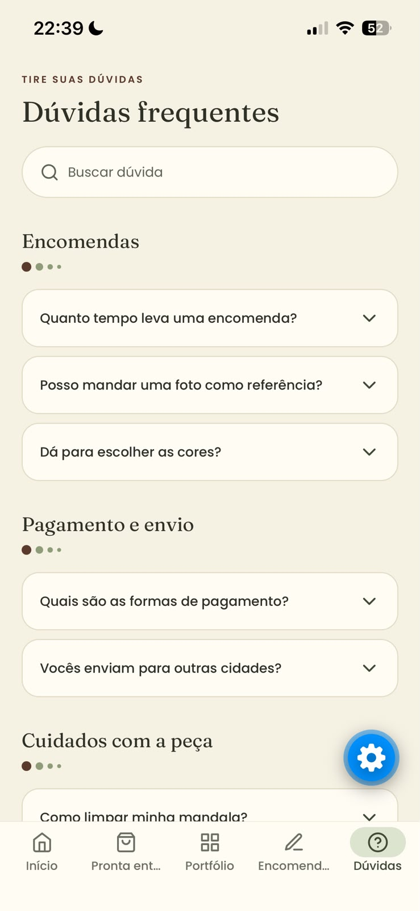
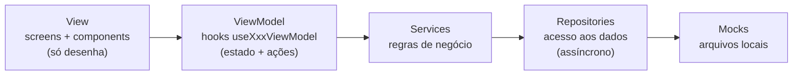

# Malu Mandalas — app do ateliê

Aplicativo mobile do ateliê **Malu Mandalas** ([@malu.mandalas](https://www.instagram.com/malu.mandalas)), que produz mandalas artesanais pintadas à mão na técnica de **pontilhismo**.

O ateliê trabalha de dois jeitos, e o app foi pensado em cima disso:

- **Pronta entrega:** peças com estilo já definido (Sol, Lua, Flor de Lótus...), prontas para venda.
- **Encomendas:** peças personalizadas, feitas a partir da história de quem encomenda (família, pet, homenagem, casal). As encomendas já entregues formam o **portfólio**.

Trabalho individual da disciplina **Programação para Dispositivos Móveis** (FAMINAS), desenvolvido com **React Native + Expo (Managed Workflow) + TypeScript**.

---

## Telas

<table>
  <tr>
    <td align="center"><br><b>Início</b></td>
    <td align="center"><br><b>Pronta entrega</b></td>
    <td align="center"><br><b>Detalhe da mandala</b></td>
  </tr>
  <tr>
    <td align="center"><br><b>Portfólio</b></td>
    <td align="center"><br><b>Encomenda</b></td>
    <td align="center"><br><b>Dúvidas (FAQ)</b></td>
  </tr>
</table>

| # | Tela | O que faz |
|---|------|-----------|
| 1 | **Início** | Apresenta o ateliê: boas-vindas, a história da Malu, o significado da mandala e a técnica do pontilhismo. Atalhos para a Pronta entrega, a Encomenda e o Portfólio. |
| 2 | **Pronta entrega** | Grade com as peças à venda (nome, tamanho e preço) e **busca por nome ou cor**, sem diferenciar acentos. Tocar num card abre o Detalhe. |
| 3 | **Detalhe da mandala** | Recebe o **`mandalaId`** por parâmetro. Mostra imagem, técnica, tamanho e a história da peça. O botão muda conforme a origem: **"Tenho interesse"** (abre o WhatsApp com mensagem pronta) ou **"Quero uma assim"** (leva à Encomenda com o tema já escolhido). Tem botão de **compartilhar**. |
| 4 | **Portfólio** | Encomendas já entregues, com **filtro por tema** (Família, Pet, Homenagem, Casal, Outro). Usa a mesma tela de Detalhe. |
| 5 | **Encomenda** | Formulário de pedido personalizado: nome, WhatsApp com máscara, tema, tamanho, cores, ideia (com contador), presente. **Estimativa de preço e prazo ao vivo**, validação dos campos e confirmação com número de protocolo. |
| 6 | **Dúvidas (FAQ)** | Perguntas agrupadas por categoria numa **SectionList**, com busca e respostas que abrem e fecham. Atalho para falar com o ateliê no WhatsApp. |

---

## Como executar

### Pré-requisitos
- [Node.js](https://nodejs.org/) LTS (testado com a versão 24)
- Git
- Celular com o app **Expo Go** atualizado (compatível com o **SDK 57**)
- Uma conta gratuita na [Expo](https://expo.dev/signup), necessária para abrir o projeto no Expo Go do **iPhone**

### Passo a passo

```bash
# 1. Clonar o repositório
git clone https://github.com/princ1sval/atelie-mandalas-app.git

# 2. Entrar na pasta do projeto Expo (fica dentro do repositório)
cd atelie-mandalas-app/atelie-mandalas-app

# 3. Instalar as dependências
npm install

# 4. Iniciar o servidor de desenvolvimento
npx expo start
```

5. Leia o **QR code** que aparece no terminal:
   - **Android:** pelo próprio app Expo Go.
   - **iPhone:** pela câmera. No iPhone, o Expo Go (SDK 57) exige login **na mesma conta Expo** no computador e no celular:
     ```bash
     npx expo login
     ```
     No Expo Go, toque no ícone de conta (canto superior direito) e entre com a mesma conta.
6. O computador e o celular precisam estar **na mesma rede Wi-Fi**. Redes que bloqueiam essa conexão, como a da faculdade, podem impedir o acesso. Nesse caso, use o roteador do celular (hotspot).

### Comandos úteis

| Comando | Para que serve |
|---------|----------------|
| `npx expo start --clear` | Inicia limpando o cache (útil depois de instalar bibliotecas) |
| `npx tsc --noEmit` | Confere os tipos do TypeScript sem gerar arquivos |
| `npx expo-doctor` | Verifica se as versões das bibliotecas combinam com o SDK |

---

## Arquitetura: MVVM

O app segue o padrão **MVVM (Model–View–ViewModel)**, com o ViewModel implementado como **custom hook** do React (`useXxxViewModel`).



| Camada | Pasta | Responsabilidade |
|--------|-------|------------------|
| **Model** | `src/model` | Tipos e entidades: `Mandala`, `PedidoEncomenda`, `PerguntaFaq`, `Atelie`. |
| **View** | `src/view` | Telas e componentes. Só desenham o que o ViewModel entrega e repassam as ações do usuário. **Não têm regra de negócio.** |
| **ViewModel** | `src/viewmodel` | Um hook por tela. Guarda o estado (`useState`), carrega os dados (`useEffect`), calcula valores derivados (`useMemo`) e expõe ações. Cada um tem uma `interface` que é o contrato com a tela. |
| **Services** | `src/services` | Regras de negócio: separar pronta entrega e portfólio, buscar sem acento, filtrar por tema, decidir o botão do Detalhe, validar o pedido, estimar preço e prazo, agrupar o FAQ, montar os links do WhatsApp. |
| **Repositories** | `src/data/repositories` | Única porta de acesso aos dados. Cada um tem uma `interface` (contrato) e uma implementação que hoje lê os mocks. |
| **Mocks** | `src/data/mocks` | Dados falsos em arquivos locais. |

### Por que MVVM?

- **É o encaixe mais natural no React Native:** os hooks já são uma forma de separar "estado + lógica" da "interface". Cada tela tem o seu `useXxxViewModel`, e o componente da tela fica responsável só por desenhar.
- **Telas sem regra de negócio:** a View não sabe de onde vêm os dados nem como são filtrados. Ela chama, por exemplo, `vm.alterarBusca(texto)` e mostra `vm.mandalas`.
- **O ViewModel não conhece a View:** ele não sabe que existem telas, botões ou navegação. Quando uma ação precisa navegar (como o "Quero uma assim"), a tela passa uma função para o ViewModel.
- **Pronto para a Parte 2:** como os Repositories já são **assíncronos** (retornam `Promise`, imitando uma API) e têm interface, trocar a fonte de dados não exige mudar telas nem ViewModels (veja [Preparação para a Parte 2](#preparação-para-a-parte-2)).
- **Fácil de testar e explicar:** as regras ficam em funções puras nos Services, separadas da interface.

---

## Estrutura de pastas

Organização **por tipo** (camada), coerente com o MVVM:

```
atelie-mandalas-app/                 ← repositório
├── README.md
├── docs/screenshots/                ← imagens deste README
└── atelie-mandalas-app/             ← projeto Expo
    ├── App.tsx                      ← carrega as fontes e monta a navegação
    ├── app.json                     ← nome, ícone e configurações do app
    ├── assets/
    │   └── mandalas/                ← imagens das mandalas
    └── src/
        ├── model/                   ← MODEL: tipos e entidades
        │   ├── Atelie.ts
        │   ├── Encomenda.ts
        │   ├── Faq.ts
        │   └── Mandala.ts
        ├── data/
        │   ├── mocks/               ← dados falsos (arquivos locais)
        │   │   ├── atelie.mock.ts
        │   │   ├── faq.mock.ts
        │   │   └── mandalas.mock.ts
        │   └── repositories/        ← acesso aos dados (interface + implementação)
        │       ├── AtelieRepository.ts
        │       ├── EncomendaRepository.ts
        │       ├── FaqRepository.ts
        │       └── MandalaRepository.ts
        ├── services/                ← regras de negócio
        │   ├── AtelieService.ts
        │   ├── EncomendaService.ts
        │   ├── FaqService.ts
        │   └── MandalaService.ts
        ├── viewmodel/               ← VIEWMODEL: um hook por tela
        │   ├── useInicioViewModel.ts
        │   ├── useProntaEntregaViewModel.ts
        │   ├── useDetalheMandalaViewModel.ts
        │   ├── usePortfolioViewModel.ts
        │   ├── useEncomendaViewModel.ts
        │   └── useFaqViewModel.ts
        ├── view/                    ← VIEW
        │   ├── screens/             ← as 6 telas
        │   ├── components/          ← componentes autorais reutilizáveis
        │   ├── hooks/               ← hooks visuais (useGrade: colunas responsivas)
        │   └── styles/              ← tema: colors, spacing, typography, icons, theme
        ├── navigation/              ← navegadores e tipos das rotas
        │   ├── AppNavigator.tsx     ← Tab (raiz)
        │   ├── ProntaEntregaStack.tsx
        │   ├── PortfolioStack.tsx
        │   ├── opcoesStack.ts
        │   ├── temaNavegacao.ts
        │   └── types.ts             ← ParamLists e props tipadas
        └── utils/                   ← funções puras de apoio
            ├── esperar.ts
            ├── formatters.ts        ← moeda, faixa de preço, telefone, plural
            ├── texto.ts             ← normalizar texto, apenas dígitos
            └── validators.ts
```

---

## Navegação

**React Navigation 7**, com navegação **aninhada**: **Tab** na raiz e um **Stack** dentro das abas Pronta entrega e Portfólio. Todas as rotas são **tipadas** em `src/navigation/types.ts`.

```
Tab.Navigator (raiz)
├── Inicio
├── ProntaEntregaTab ─ Stack ─┬─ ProntaEntrega
│                             └─ DetalheMandala   { mandalaId: string }
├── PortfolioTab ───── Stack ─┬─ Portfolio
│                             └─ DetalheMandala   { mandalaId: string }
├── Encomendar                   { tema?: TemaEncomenda; inspiracaoId?: string }
└── Duvidas
```

- Cada aba com Stack guarda **o próprio histórico**.
- Os parâmetros são sempre **simples (serializáveis)**: passa-se o **id**, e o Detalhe busca a mandala pelo Service.
- `CompositeScreenProps` permite que uma tela dentro de um Stack navegue para outra aba. É assim que "Quero uma assim" vai do Detalhe para a aba Encomendar levando `tema` e `inspiracaoId`.
- A mesma tela `DetalheMandalaScreen` é usada nos dois Stacks.

---

## Componentes

### Componentes autorais (com props tipadas e reutilizados)

| Componente | Props principais | Usado em |
|------------|------------------|----------|
| `BotaoPrimario` | `titulo`, `onPress`, `variante`, `icone`, `carregando`, `desabilitado` | Início, Detalhe, Encomenda, Dúvidas, MensagemEstado |
| `CampoTexto` | `rotulo`, `erro`, `icone`, `formato`, `mostrarContador` + todas as props de `TextInput` | Pronta entrega, Encomenda, Dúvidas |
| `Chip` | `rotulo`, `selecionado`, `onPress` | Portfólio (filtro), Encomenda (tema e tamanho) |
| `TituloSecao` | `titulo`, `sobretitulo`, `descricao`, `nivel` | Todas as telas |
| `MandalaCard` | `mandala`, `onPress`, `style` | Pronta entrega, Portfólio |
| `GradeMandalas` | `mandalas`, `onAbrirMandala`, `mensagemVazia` | Pronta entrega, Portfólio |
| `MensagemEstado` | `tipo` (carregando, erro ou vazio), `mensagem`, `onTentarNovamente` | Início, Pronta entrega, Detalhe, Portfólio, Dúvidas |

### Componentes nativos do React Native usados

`View`, `Text`, `Image`, `ScrollView`, **`FlatList`** (grade de mandalas), **`SectionList`** (FAQ), **`TextInput`** (busca e formulário), `Pressable`, `Switch`, `Modal`, `ActivityIndicator`. Também são usadas as APIs `Linking` (WhatsApp), `Share` (compartilhar), `Keyboard`, `Platform` e `useWindowDimensions`.

---

## Estilização e responsividade

- Todos os estilos fixos usam **`StyleSheet.create`**. O estilo inline aparece só para valores dinâmicos, como a largura calculada de cada card.
- **Tema centralizado** em `src/view/styles/`:
  - `colors.ts`: paleta do ateliê (tirada do Instagram). É o **único arquivo com códigos de cor**.
  - `spacing.ts`: escala de espaçamentos e arredondamentos.
  - `typography.ts`: fontes **Fraunces** (títulos) e **Poppins** (textos) e estilos de texto prontos.
  - `theme.ts`: reúne tudo, mais a sombra por plataforma (`Platform.select`) e a largura máxima.
- **Layout adaptável:**
  - `useGrade` usa `useWindowDimensions` para mostrar **2 colunas no celular e 3 no tablet**, com a largura exata de cada card.
  - Em telas largas, o conteúdo de leitura fica limitado a 640 de largura e centralizado (`larguraMaxima`).
  - Layout em flexbox com `gap`, `SafeAreaView` para respeitar o entalhe e ajuste automático do teclado nos formulários.

---

## Tecnologias e bibliotecas

| Biblioteca | Versão | Uso |
|------------|--------|-----|
| Expo (Managed Workflow) | SDK 57 | Base do projeto |
| React Native | 0.86 | Interface nativa |
| React | 19.2 | Componentes e hooks |
| TypeScript | 6.0 | Tipagem |
| @react-navigation/native, native-stack, bottom-tabs | 7.x | Navegação (Tab + Stack) |
| react-native-screens / react-native-safe-area-context | 4.26 / 5.7 | Dependências da navegação e áreas seguras |
| @expo/vector-icons (Feather) | 15 | Ícones |
| expo-font + @expo-google-fonts (Fraunces e Poppins) | 57 / 0.4 | Fontes da identidade visual |

Todas as bibliotecas foram instaladas com **`npx expo install`**, que escolhe a versão compatível com o SDK.

---

## Preparação para a Parte 2

A fonte de dados pode ser trocada (API, banco local etc.) **mexendo só nos Repositories**. Cada Repository tem uma interface, por exemplo:

```ts
export interface MandalaRepository {
  listar(): Promise<Mandala[]>;
  buscarPorId(id: string): Promise<Mandala | undefined>;
}
```

Hoje a implementação lê o mock. Para usar uma API, basta outra implementação com a mesma interface:

```ts
export const mandalaRepository: MandalaRepository = {
  async listar() {
    const resposta = await fetch('https://sua-api.com/mandalas');
    return resposta.json();
  },
  async buscarPorId(id) {
    const resposta = await fetch(`https://sua-api.com/mandalas/${id}`);
    return resposta.ok ? resposta.json() : undefined;
  },
};
```

Services, ViewModels e telas continuam iguais. Os ViewModels já tratam **carregando** e **erro** (com o botão "Tentar de novo"), que passam a fazer diferença quando os dados vierem da rede. O tipo `ImagemMandala` também já aceita imagem local (`require`) ou da internet (`{ uri }`).

---

## Requisitos do trabalho

| Requisito | Como foi atendido |
|-----------|-------------------|
| Expo Managed + TypeScript, commits progressivos | Template `blank-typescript` (SDK 57), um commit por etapa |
| Mínimo de 6 telas com propósito real | Início, Pronta entrega, Detalhe, Portfólio, Encomenda, Dúvidas |
| Tab ou Drawer na raiz + Stack interno | Tab na raiz + Stacks de Pronta entrega e Portfólio |
| Tela que recebe parâmetros e rotas tipadas | `DetalheMandala { mandalaId }` e `Encomendar { tema?, inspiracaoId? }`, em `navigation/types.ts` |
| 6+ componentes nativos, com lista e campo de entrada | 11 componentes, entre eles `FlatList`, `SectionList` e `TextInput` |
| 3+ componentes autorais tipados e reutilizados | 7 componentes, cada um usado em mais de uma tela |
| MVC, MVP ou MVVM aplicado de forma consistente | MVVM: 6 telas e 6 ViewModels; regras nos Services |
| Pastas coerentes com a arquitetura | Organização por tipo (camada) |
| `StyleSheet.create`, tema centralizado, layout adaptável | Tema em `view/styles`, sem cores soltas, grade responsiva |
| Biblioteca de terceiros via `npx expo install` | React Navigation, @expo/vector-icons, expo-font e Google Fonts |
| Dados mockados acessados por camada própria | Mocks → Repositories → Services |

---

## Observações

- As **imagens das mandalas** são ilustrações provisórias criadas para o protótipo. As fotos reais das peças do ateliê vão substituí-las mantendo os mesmos nomes de arquivo. Fotos de encomendas (pessoas, pets, homenagens) só entram com autorização dos clientes.
- **Preços, prazos e o número de WhatsApp** são provisórios. O número fica em `src/data/mocks/atelie.mock.ts`.
- O envio de encomenda é **simulado**: o Repository gera um número de protocolo e guarda o pedido só na memória enquanto o app está aberto.

---

## Autor

**João Pedro Batista Princisval**
Análise e Desenvolvimento de Sistemas, FAMINAS
Disciplina: Programação para Dispositivos Móveis, prof. Thiago Goldoni Thomé
