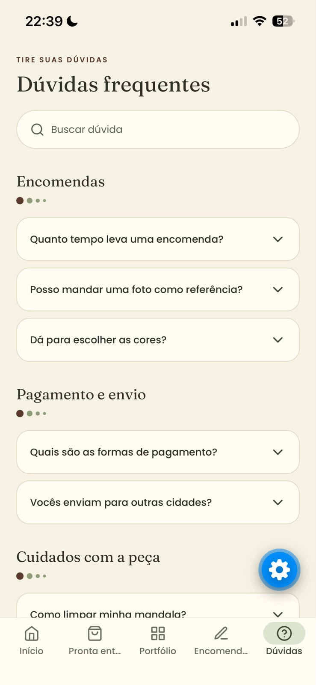
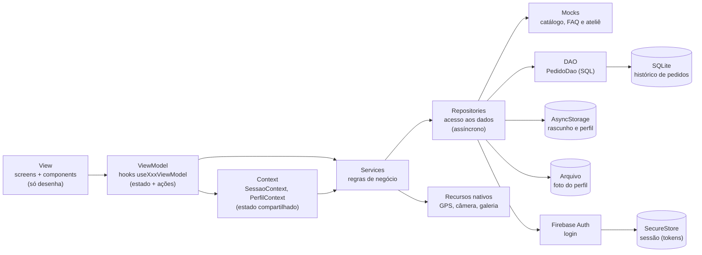

# Malu Mandalas — app do ateliê

Aplicativo mobile do ateliê **Malu Mandalas** ([@malu.mandalas](https://www.instagram.com/malu.mandalas)), que produz mandalas artesanais pintadas à mão na técnica de **pontilhismo**.

O ateliê trabalha de dois jeitos, e o app foi pensado em cima disso:

- **Pronta entrega:** peças com estilo já definido (Sol, Lua, Flor de Lótus...), prontas para venda.
- **Encomendas:** peças personalizadas, feitas a partir da história de quem encomenda (família, pet, homenagem, casal). As encomendas já entregues formam o **portfólio**.

Trabalho individual da disciplina **Programação para Dispositivos Móveis** (FAMINAS), desenvolvido com **React Native + Expo (Managed Workflow) + TypeScript**.

---

## Telas

<table>
  <tr>
    <td align="center"><br><b>Início</b></td>
    <td align="center"><br><b>Pronta entrega</b></td>
    <td align="center"><br><b>Detalhe da mandala</b></td>
  </tr>
  <tr>
    <td align="center"><br><b>Portfólio</b></td>
    <td align="center"><br><b>Encomenda</b></td>
    <td align="center"><br><b>Dúvidas (FAQ)</b></td>
  </tr>
</table>

| # | Tela | O que faz |
|---|------|-----------|
| 1 | **Início** | Apresenta o ateliê: boas-vindas, a história da Malu, o significado da mandala e a técnica do pontilhismo. Atalhos para a Pronta entrega, a Encomenda e o Portfólio. |
| 2 | **Pronta entrega** | Grade com as peças à venda (nome, tamanho e preço) e **busca por nome ou cor**, sem diferenciar acentos. Tocar num card abre o Detalhe. **Chacoalhar o celular** (acelerômetro) sorteia uma peça e abre o Detalhe dela. |
| 3 | **Detalhe da mandala** | Recebe o **`mandalaId`** por parâmetro. Mostra imagem, técnica, tamanho e a história da peça. O botão muda conforme a origem: **"Tenho interesse"** (abre o WhatsApp com mensagem pronta) ou **"Quero uma assim"** (leva à Encomenda com o tema já escolhido). Tem botão de **compartilhar**. |
| 4 | **Portfólio** | Encomendas já entregues, com **filtro por tema** (Família, Pet, Homenagem, Casal, Outro). Usa a mesma tela de Detalhe. |
| 5 | **Encomenda** | Formulário de pedido personalizado: nome, WhatsApp com máscara, tema, tamanho, cores, ideia (com contador), presente. **Estimativa de preço e prazo ao vivo**, validação dos campos e confirmação com número de protocolo. O que foi preenchido fica salvo como **rascunho** e volta quando o app é reaberto. |
| 6 | **Dúvidas (FAQ)** | Perguntas agrupadas por categoria numa **SectionList**, com busca e respostas que abrem e fecham. Atalho para falar com o ateliê no WhatsApp. |
| 7 | **Meus pedidos** | Aberta pela Encomenda. Mostra o **histórico salvo no aparelho** (SQLite), do pedido mais recente para o mais antigo, com protocolo, data e estimativa. Cada pedido pode ser **excluído**, e **"Apagar meus dados"** remove tudo o que o app guardou. |
| 8 | **Entrar** | Login por e-mail e senha no **Firebase Authentication**. O catálogo é aberto para todos: a conta só é pedida na hora de enviar uma encomenda. |
| 9 | **Criar conta** | Cadastro com e-mail, senha e confirmação, validados antes de ir para o Firebase. Os erros do Firebase aparecem em português. |
| 10 | **Perfil** | Nome, WhatsApp, **foto pela câmera ou pela galeria** e **cidade pelo GPS**, com a distância até o ateliê. O perfil preenche a encomenda e a saudação do Início. Mostra a conta logada e o botão de sair. |

---

## Como executar

### Pré-requisitos
- [Node.js](https://nodejs.org/) LTS (testado com a versão 24)
- Git
- Celular com o app **Expo Go** atualizado, compatível com o **SDK 58**. No iPhone só existe a versão mais recente do Expo Go: quando ela mudar de SDK, o projeto precisa ser atualizado junto
- Uma conta gratuita na [Expo](https://expo.dev/signup), necessária para abrir o projeto no Expo Go do **iPhone**

### Passo a passo

```bash
# 1. Clonar o repositório
git clone https://github.com/princ1sval/atelie-mandalas-app.git

# 2. Entrar na pasta do projeto Expo (fica dentro do repositório)
cd atelie-mandalas-app/atelie-mandalas-app

# 3. Instalar as dependências
npm install

# 4. Configurar o Firebase (login): copiar o modelo e preencher com as chaves do app Web
#    (console do Firebase › Configurações do projeto › Seus apps). O .env fica fora do git.
cp .env.example .env

# 5. Iniciar o servidor de desenvolvimento
npx expo start
```

> Sem o `.env`, o app abre normalmente: o catálogo, a encomenda e o rascunho funcionam, e só o login fica indisponível. No console do Firebase, o provedor **E-mail/senha** precisa estar ativado em *Authentication › Sign-in method*.

6. Leia o **QR code** que aparece no terminal:
   - **Android:** pelo próprio app Expo Go.
   - **iPhone:** pela câmera. No iPhone, o Expo Go exige login **na mesma conta Expo** no computador e no celular:
     ```bash
     npx expo login
     ```
     No Expo Go, toque no ícone de conta (canto superior direito) e entre com a mesma conta.
7. O computador e o celular precisam estar **na mesma rede Wi-Fi**. Redes que bloqueiam essa conexão, como a da faculdade, podem impedir o acesso. Nesse caso, use o roteador do celular (hotspot).
8. **Para abrir no navegador** (opcional), aperte `w` no terminal do `npx expo start`. Veja as diferenças da [versão web](#versão-web).

### Comandos úteis

| Comando | Para que serve |
|---------|----------------|
| `npx expo start --clear` | Inicia limpando o cache (útil depois de instalar bibliotecas) |
| `npm test` | Roda todos os testes do Jest (unitários, integração e UI). Veja [Testes](#testes) |
| `npx tsc --noEmit` | Confere os tipos do TypeScript sem gerar arquivos (inclui os testes) |
| `npx expo-doctor` | Verifica se as versões das bibliotecas combinam com o SDK |

---

## Arquitetura: MVVM

O app segue o padrão **MVVM (Model–View–ViewModel)**, com o ViewModel implementado como **custom hook** do React (`useXxxViewModel`).



| Camada | Pasta | Responsabilidade |
|--------|-------|------------------|
| **Model** | `src/model` | Tipos e entidades: `Mandala`, `PedidoEncomenda`, `PedidoSalvo`, `PerguntaFaq`, `Atelie`, `Perfil`, `Usuario`. |
| **View** | `src/view` | Telas e componentes. Só desenham o que o ViewModel entrega e repassam as ações do usuário. **Não têm regra de negócio.** |
| **ViewModel** | `src/viewmodel` | Um hook por tela. Guarda o estado (`useState`), carrega os dados (`useEffect`), calcula valores derivados (`useMemo`) e expõe ações. Cada um tem uma `interface` que é o contrato com a tela. |
| **Context** | `src/context` | Estado compartilhado entre telas distantes: quem está logado (`SessaoContext`) e o perfil salvo (`PerfilContext`, com `useReducer`). Cada um tem o seu Provider e o seu hook (`useSessao`, `usePerfil`). Veja [Contexto](#contexto). |
| **Services** | `src/services` | Regras de negócio: separar pronta entrega e portfólio, buscar sem acento, filtrar por tema, decidir o botão do Detalhe, validar o pedido, estimar preço e prazo, guardar e conferir o rascunho, apagar os dados da cliente, agrupar o FAQ, montar os links do WhatsApp. |
| **Repositories** | `src/data/repositories` e `src/data/remote` | Única porta de acesso aos dados. Cada um tem uma `interface` (contrato) e uma implementação: os do catálogo, do FAQ e do ateliê leem os mocks; o de encomendas grava no SQLite, pelo DAO; os de rascunho e perfil usam o AsyncStorage; o de foto guarda o arquivo na pasta do app; o de autenticação fala com o Firebase. |
| **DB** | `src/db` | Banco SQLite: abre a conexão (`dbConfig.ts`), aplica as migrations (`migrations.ts`) e reúne o SQL da tabela de pedidos (`PedidoDao.ts`). |
| **Mocks** | `src/data/mocks` | Dados falsos em arquivos locais. |

### Por que MVVM?

- **É o encaixe mais natural no React Native:** os hooks já são uma forma de separar "estado + lógica" da "interface". Cada tela tem o seu `useXxxViewModel`, e o componente da tela fica responsável só por desenhar.
- **Telas sem regra de negócio:** a View não sabe de onde vêm os dados nem como são filtrados. Ela chama, por exemplo, `vm.alterarBusca(texto)` e mostra `vm.mandalas`.
- **O ViewModel não conhece a View:** ele não sabe que existem telas, botões ou navegação. Quando uma ação precisa navegar (como o "Quero uma assim"), a tela passa uma função para o ViewModel.
- **Fonte de dados trocável:** como os Repositories já são **assíncronos** (retornam `Promise`, imitando uma API) e têm interface, trocar a fonte de dados não exige mudar telas nem ViewModels. Foi assim que o histórico passou para o SQLite e o login entrou com o Firebase (veja [Trocar a fonte de dados](#trocar-a-fonte-de-dados)).
- **Fácil de testar e explicar:** as regras ficam em funções puras nos Services, separadas da interface. É por isso que a maior parte dos testes unitários testa Services e utils sem precisar desenhar nenhuma tela.

---

## Contexto

Pela regra da disciplina, **só vai para o contexto o que é lido ou alterado em telas distantes**. O resto continua em `useState`, dentro do ViewModel de cada tela.

| Contexto | O que guarda | Quem lê | Quem altera | Por que é contexto |
|----------|--------------|---------|-------------|--------------------|
| `SessaoContext` (`src/context/SessaoContext.tsx`) | Usuário logado e `verificando` (o Firebase ainda lendo a sessão salva) | Aba Perfil (mostra Entrar ou Perfil), Encomenda (pede login ao enviar), Perfil (mostra o e-mail) | Entrar, Criar conta e Sair, pelo Firebase | São três abas diferentes. Antes, cada tela abria a própria escuta do `onAuthStateChanged`; com o Provider há **uma escuta só** para o app todo |
| `PerfilContext` (`src/context/PerfilContext.tsx`) | Perfil salvo (nome, WhatsApp, foto, cidade), `carregando` e `erro` | Início (saudação "Olá, Ana!"), Encomenda (preenche nome e WhatsApp), Perfil | Perfil ("Salvar") e Meus pedidos ("Apagar meus dados") | As abas ficam montadas e precisam do mesmo perfil. Na Parte 1 isso era feito com um observer manual dentro do `PerfilService`; o contexto é o mecanismo do React para esse caso |

Como foram feitos:

- **Um contexto por responsabilidade**: sessão e perfil mudam por motivos diferentes, então quem só lê a sessão não redesenha quando o perfil muda.
- **Provider + hook customizado**: as telas chamam `useSessao()` e `usePerfil()`, sem conhecer o `createContext`. Usado fora do Provider, o hook lança um erro claro.
- **`value` memoizado com `useMemo`**, e as funções do contexto com `useCallback`, para não redesenhar quem consome sem necessidade.
- **`useReducer` no perfil** (`src/context/perfilReducer.ts`): o perfil passa por `carregando`, `carregou`, `falhou` e `salvou`. O reducer é uma função pura, testada em `__tests__/unit/perfilReducer.test.ts`.
- **Padrão da persistência**: o `PerfilProvider` lê do AsyncStorage quando o app abre, o estado muda durante o uso e grava no "Salvar".
- Os Providers ficam no `App.tsx`, **por fora da navegação**, para valer em todas as abas.

**Continua em `useState`** (estado local de UI): o que a cliente está digitando no Perfil antes de salvar, o formulário de encomenda, os erros de validação, o modal de confirmação, a busca, a pergunta aberta no FAQ e os avisos de permissão.

---

## Recursos nativos e permissões

O app usa **um sensor e três recursos nativos**, todos com função real no tema e todos do Expo SDK, para funcionar no Expo Go:

| Recurso | Biblioteca | Onde | Para quê | Permissão |
|---------|------------|------|----------|-----------|
| **Acelerômetro** (sensor) | `expo-sensors` | Pronta entrega (`view/hooks/useChacoalhar.ts`) | Chacoalhar o celular sorteia uma peça à venda, para a cliente descobrir mandalas | Nenhuma |
| **Localização** | `expo-location` | Perfil (`services/LocalizacaoService.ts`) | Preencher a cidade do perfil e mostrar a distância até o ateliê, que ajuda a combinar a entrega | Só com o app em uso (*when in use*) |
| **Câmera** | `expo-image-picker` | Perfil (`services/ImagemService.ts`) | Tirar a foto do perfil | Câmera |
| **Galeria** | `expo-image-picker` | Perfil (`services/ImagemService.ts`) | Escolher a foto do perfil | Fotos |

**Permissões:**

- Cada permissão é pedida **na hora do toque** ("Tirar foto", "Escolher da galeria", "Usar minha localização"), e nunca ao abrir o app.
- **Negar não trava o app**: o perfil funciona sem foto, e a cidade pode ser digitada. A tela mostra um aviso e o botão **"Abrir Ajustes"** (`Linking.openSettings()`), porque depois de negar o sistema pode nem perguntar de novo.
- Os casos são tratados separadamente: permissão negada, GPS desligado, cidade não encontrada e a pessoa que desistiu da foto (este último não mostra aviso).
- No `app.json`, cada permissão tem o texto em português explicando o uso. O **microfone** e a **localização em segundo plano** estão desligados, porque o app não usa.

**Sensor:**

- Antes de ligar, o app confere se o aparelho tem o sensor (`Accelerometer.isAvailableAsync()`). Sem sensor, ou no navegador, a dica nem aparece.
- O sensor só fica ligado **com a tela visível** (`useFocusEffect`), e o listener é removido no cleanup (`assinatura.remove()`). Assim ele não gasta bateria nem abre mandalas em outra aba.
- A regra da chacoalhada é uma função pura (`utils/movimento.ts`): a força total √(x² + y² + z²) passa de 1,8 g. Parado na mesa, o celular mede cerca de 1 g, só pela gravidade. Depois de uma chacoalhada há uma pausa de 1 s, para não disparar duas vezes.

**Privacidade da localização:** as coordenadas servem só para achar a cidade e calcular a distância (fórmula de Haversine, `utils/distancia.ts`) e são descartadas na hora. O app guarda só a cidade, e só se a cliente tocar em "Salvar".

---

## Persistência e privacidade

Seguindo o material **18 – Persistência**, cada dado fica no lugar que combina com o tipo dele (mapa de decisão da seção 7.1):

| Dado | Onde fica | Por quê |
|------|-----------|---------|
| Histórico de pedidos: protocolo, tema, tamanho, cores, ideia, presente, inspiração, estimativa e data | **SQLite** (`expo-sqlite`), tabela `pedidos` | Dado estruturado: uma lista que cresce e aparece em ordem (seção 4.1) |
| Rascunho do formulário de encomenda | **AsyncStorage**, chave `@malu-mandalas/rascunho-encomenda` (JSON) | Chave-valor: um único objeto, sobrescrito a cada alteração e sem busca (seção 3.1) |
| Perfil: nome, WhatsApp, cidade e o caminho da foto | **AsyncStorage**, chave `@malu-mandalas/perfil` (JSON) | Configuração da cliente, chave-valor, como o rascunho |
| Foto do perfil | **Arquivo** na pasta de documentos do app (`expo-file-system`, pasta `perfil/`) | É binário: o AsyncStorage guarda só o caminho. A foto sai do cache, que o sistema pode limpar, e vai para uma pasta que só some ao desinstalar o app (seção 6) |
| Sessão do login (tokens do Firebase) | **SecureStore** (`expo-secure-store`), pelo `data/remote/armazenamentoSeguro.ts` | Dado sensível: fica criptografado pelo Keychain (iOS) e pelo Keystore (Android), e nunca no AsyncStorage (seções 3.3 e 7.1) |
| Senha | **Não é guardada** | Vai direto para o Firebase (seção 7.2) |
| Nome e WhatsApp depois do envio | **Não vão para o histórico** | O histórico não precisa deles (seção 7.3) |
| Coordenadas do GPS | **Não são guardadas** | Só a cidade fica, e só se a cliente salvar o perfil |
| Mandalas, perguntas do FAQ, dados do ateliê e preços | **No código** (mocks) | São do app e só de leitura |
| Cartão de crédito | **Não existe no app** | O pagamento é combinado pelo WhatsApp |

O perfil e a sessão, além de persistidos, ficam num **contexto** enquanto o app está aberto, para todas as telas verem o mesmo valor (veja [Contexto](#contexto)).

### SQLite: configuração e migrations

- O banco `malu-mandalas.db` abre uma vez, quando o app inicia, em `src/db/dbConfig.ts`, com **WAL**, **foreign_keys** ligado e `synchronous = NORMAL` (seções 4.4 e 4.5).
- A estrutura evolui por **migrations**, controladas pelo `PRAGMA user_version` (seção 4.3). Cada uma roda **uma vez por aparelho** e **dentro de uma transação**: ou é aplicada inteira, ou nada muda.

| Versão | O que faz |
|--------|-----------|
| 1 | Cria a tabela `pedidos`, já sem colunas de nome e WhatsApp |
| 2 | Acrescenta a estimativa (`precoMinimo`, `precoMaximo`, `prazoDias`) com `ALTER TABLE`, sem apagar os pedidos que já existiam. Esses aparecem com "Estimativa não registrada" |

- Para mudar o banco, acrescenta-se uma versão nova no fim da lista. Uma versão que já rodou nunca é editada, porque os aparelhos que a aplicaram não a rodariam de novo.
- Todo o SQL da tabela fica no `PedidoDao`, com `?` no lugar dos valores: o texto digitado nunca vira parte do comando.

### Rascunho no AsyncStorage

- É salvo 500 ms depois da última alteração, e não a cada letra.
- Só começa a salvar depois de ler o rascunho anterior. Antes disso, o formulário ainda vazio o apagaria.
- O tema e a inspiração vindos do "Quero uma assim" têm prioridade sobre os do rascunho.
- É apagado quando o pedido é enviado e quando o formulário fica vazio.
- O que vem do armazenamento é conferido antes de voltar à tela: um JSON estragado ou um campo estranho não quebra o formulário.

### Privacidade (LGPD, seção 7.3)

- **Os dados da cliente ficam neste aparelho.** O envio do pedido é simulado, e os pedidos, o rascunho e o perfil não saem do celular. O que vai para a internet é só o login: o e-mail e a senha vão para o Firebase Authentication.
- **Só o necessário:** o histórico não guarda nome nem WhatsApp; o rascunho não repete o nome e o WhatsApp que já estão no perfil e existe só enquanto o formulário está sendo preenchido; do GPS fica só a cidade.
- **A cliente pode apagar tudo:** em Meus pedidos, cada pedido pode ser excluído, e **"Apagar meus dados"** remove o rascunho, o perfil com o arquivo da foto e todo o histórico. O catálogo continua, porque é do app e não da cliente (seção 9.3).
- **Ao desinstalar o app**, o SQLite, o AsyncStorage e a pasta da foto são apagados (seção 8.1). Um backup do aparelho, no iCloud ou no Google, pode restaurá-los (seção 8.3).
- A ideia da encomenda é texto livre e pode citar algo sensível, como numa homenagem. Por isso a exclusão está sempre à mão.

### Diferenças em relação ao material

- **Transação nas migrations:** sem ela, uma falha no meio deixaria o banco pela metade.
- **`datetime('now', 'localtime')`:** o `datetime('now')` grava em UTC, 3 horas à frente de Brasília.
- **Migration 2 sem `DEFAULT`:** o `DEFAULT (datetime(...))` do exemplo da seção 10 falha em `ALTER TABLE`. Aqui os pedidos antigos ficam com a estimativa em branco (NULL).
- **Histórico ordenado por `id`:** a seção 4.2 ordena pela data, mas dois pedidos no mesmo segundo empatariam.
- **`JSON.parse` protegido:** um rascunho estragado é ignorado em vez de quebrar a tela.
- **Sem MMKV:** o MMKV exige development build, e o app roda no Expo Go.
- **SecureStore como armazenamento do Firebase:** o Firebase guarda a sessão num armazenamento com `getItem`, `setItem` e `removeItem`. O `armazenamentoSeguro.ts` entrega o SecureStore nesse formato. Como o SecureStore só aceita letras, números, `.`, `-` e `_` no nome da chave, e o Firebase usa `:` e `[`, esses caracteres viram `_`.

### Versão web

O app também abre no navegador (tecla `w` no `npx expo start`). O `metro.config.js` permite o SQLite na web, que roda em WebAssembly e precisa de dois cabeçalhos de segurança. O que muda em relação ao celular:

- ao iniciar o app, a primeira abertura do banco falha porque o worker do `expo-sqlite` ainda está carregando, e aparece um erro no console; a chamada seguinte abre o banco normalmente;
- o banco do navegador não usa WAL (`journal_mode=delete`);
- os dados ficam no armazenamento do navegador, separados dos do celular;
- as confirmações usam o `confirm` do navegador, porque o `Alert` do React Native não funciona na web;
- a foto do perfil, a localização e o chacoalhar ficam desligados: no navegador não há onde guardar o arquivo da foto, o `expo-location` não converte coordenadas em cidade, e o acelerômetro não mede aceleração de verdade.

---

## Testes

Os testes ficam em pastas separadas por tipo, na pasta do projeto Expo:

```
atelie-mandalas-app/
├── jest.setup.ts            ← mocks das bibliotecas nativas (AsyncStorage, SecureStore, SQLite, Firebase)
├── __tests__/
│   ├── unit/                ← testes unitários
│   ├── integration/         ← testes de integração
│   ├── ui/                  ← testes de interface (React Native Testing Library)
│   └── helpers/             ← SQLite de teste, fábricas de dados e Providers
└── e2e/                     ← testes end-to-end (Maestro)
    ├── 01-portfolio-ate-encomenda.yaml
    ├── 02-login-encomenda-historico.yaml
    └── subflows/abrir-app.yaml
```

| Tipo | Pasta | Testes | Mínimo pedido | Comando |
|------|-------|--------|---------------|---------|
| Unitários | `__tests__/unit` | **48** | 20 | `npm run test:unit` |
| Integração | `__tests__/integration` | **34** | 10 | `npm run test:integration` |
| UI | `__tests__/ui` | **19** | 8 | `npm run test:ui` |
| End-to-end | `e2e/` | **2 fluxos** | 2 | `npm run test:e2e` (precisa do Maestro e de um emulador) |

### Como rodar

```bash
cd atelie-mandalas-app/atelie-mandalas-app
npm install

npm test                  # unitários + integração + UI (101 testes)
npm run test:unit         # só um tipo
npm run test:coverage     # com relatório de cobertura (pasta coverage/)
```

Os testes do Jest não precisam de celular, de internet nem do `.env`: tudo o que é nativo é substituído por um *test double* (veja abaixo).

### O que cada nível testa e por quê

- **Unitários (`unit/`)**: funções e regras isoladas, que são as mais rápidas e as que mais encontram erros.
  - Funções puras de `utils`: máscara de telefone, moeda, data, distância (Haversine), detecção da chacoalhada, texto sem acento.
  - Regras dos Services: preço e prazo da encomenda, validação do pedido, do perfil e da conta, tradução dos erros do Firebase, busca e filtro de mandalas, sorteio sem repetir, montagem do FAQ.
  - O `perfilReducer` do contexto.
- **Integração (`integration/`)**: partes que trabalham juntas, com o armazenamento de verdade ou com um double só no que é nativo.
  - **Service → Repository → DAO → SQLite**: as migrations e o `PedidoDao` rodam num **SQLite de verdade** em memória (`sql.js`, `helpers/bancoDeTeste.ts`). Os testes conferem que o histórico não guarda nome nem WhatsApp, que um banco na versão 1 recebe só a migration 2 sem perder pedidos, e que texto com aspas não vira SQL.
  - **Service → Repository → AsyncStorage**: rascunho e perfil (gravar, ler de volta, JSON estragado, apagar).
  - **"Apagar meus dados"** passando pelos três armazenamentos.
  - **Camada de dados com a API**: `AuthService` → `AuthRepository` → Firebase, com o Firebase como double; também o app sem o `.env` e a sessão no SecureStore.
  - **Recursos nativos**: `LocalizacaoService` (GPS desligado, permissão negada, cidade e distância) e `ImagemService` (negado, cancelado, foto).
- **UI (`ui/`)**: o que a pessoa vê e toca, com a React Native Testing Library.
  - Componentes: `BotaoPrimario`, `CampoTexto`, `Chip`, `MensagemEstado`, `MandalaCard`, `FotoPerfil`.
  - Telas inteiras com ViewModel, Services e contextos de verdade: a Encomenda (erros ao enviar vazio, estimativa ao vivo, convite para entrar) e as Dúvidas (busca e resposta que abre).
  - O `PerfilContext`: o que um componente salva aparece no outro, e a Início mostra a saudação do perfil salvo.
  - As buscas são feitas pelo papel e pelo nome acessível (`getByRole`, `getByLabelText`), como um leitor de tela faria.
- **End-to-end (`e2e/`)**: os dois fluxos mais importantes, no app de verdade.
  1. `01-portfolio-ate-encomenda.yaml`: Portfólio → filtro Pet → Detalhe → "Quero uma assim" → o formulário abre com a inspiração → **fecha e abre o app** → o rascunho continua lá (persistência) → enviar incompleto mostra os erros.
  2. `02-login-encomenda-historico.yaml`: Entrar → preencher e enviar uma encomenda → confirmação com protocolo → **Meus pedidos** mostra o pedido salvo no SQLite.

### Test doubles usados

| Dependência real | Substituto nos testes | Onde |
|------------------|-----------------------|------|
| AsyncStorage | Mock oficial do pacote, em memória | `jest.setup.ts` |
| SecureStore (Keychain/Keystore) | `Map` em memória | `jest.setup.ts` |
| expo-sqlite | SQLite real em WebAssembly (`sql.js`), em memória | `__tests__/helpers/bancoDeTeste.ts` |
| Firebase Authentication | `jest.mock` de `firebase/auth`; sem `.env`, `auth = null` | `jest.setup.ts` e `integration/AuthRepository.test.ts` |
| expo-location, expo-image-picker | `jest.mock` com respostas controladas | `integration/LocalizacaoService.test.ts`, `ImagemService.test.ts` |
| Arquivo da foto (`expo-file-system`) | `jest.mock` do `FotoRepository` | `integration/PerfilService.test.ts` |
| Espera que imita a rede (`esperar`) | Resolve na hora | `jest.setup.ts` |

### Como rodar os testes end-to-end (Maestro)

1. Instale o [Maestro](https://docs.maestro.dev/getting-started/installing-maestro) (precisa do Java 17 ou mais novo).
2. Abra um **emulador Android** (Android Studio) com o **Expo Go** e rode `npx expo start --android`. O app abre no emulador e o Expo faz o `adb reverse` da porta 8081.
3. Para o fluxo 2, crie um **usuário de teste** no console do Firebase (*Authentication › Users*). A senha nunca vai para o repositório: ela é passada na linha de comando.
4. Rode:

```bash
maestro test e2e/01-portfolio-ate-encomenda.yaml
maestro test -e EMAIL=e2e@exemplo.com -e SENHA=senhaDeTeste e2e/02-login-encomenda-historico.yaml

# os dois de uma vez
maestro test -e EMAIL=e2e@exemplo.com -e SENHA=senhaDeTeste e2e/

# celular ou emulador em outro endereço
maestro test -e EXPO_URL=exp://192.168.0.10:8081 e2e/01-portfolio-ate-encomenda.yaml
```

- Os fluxos usam o Expo Go (`appId: host.exp.exponent`) e abrem o projeto pelo link `exp://127.0.0.1:8081`, no subfluxo `e2e/subflows/abrir-app.yaml`.
- Os elementos são encontrados por `testID` (abas, campos e botões), para o teste não quebrar se um texto mudar.
- **Vídeo para a apresentação:** `maestro record --local e2e/02-login-encomenda-historico.yaml` grava a execução em vídeo. Outra opção é gravar a tela do emulador enquanto o `maestro test` roda.

---

## Estrutura de pastas

Organização **por tipo** (camada), coerente com o MVVM:

```
atelie-mandalas-app/                 ← repositório
├── README.md
├── docs/screenshots/                ← imagens deste README
└── atelie-mandalas-app/             ← projeto Expo
    ├── App.tsx                      ← carrega as fontes, abre o banco, monta os Providers e a navegação
    ├── app.json                     ← nome, ícone, permissões e configurações do app
    ├── metro.config.js              ← SQLite na versão web
    ├── .env.example                 ← modelo da configuração do Firebase (o .env fica fora do git)
    ├── jest.setup.ts                ← mocks das bibliotecas nativas para os testes
    ├── __tests__/                   ← testes do Jest: unit/, integration/, ui/ e helpers/
    ├── e2e/                         ← testes end-to-end do Maestro
    ├── assets/
    │   └── mandalas/                ← imagens das mandalas
    └── src/
        ├── model/                   ← MODEL: tipos e entidades
        │   ├── Atelie.ts
        │   ├── Encomenda.ts
        │   ├── Faq.ts
        │   ├── Mandala.ts
        │   ├── Perfil.ts
        │   └── Usuario.ts
        ├── context/                 ← estado compartilhado entre telas distantes
        │   ├── SessaoContext.tsx    ← SessaoProvider + useSessao (quem está logado)
        │   ├── PerfilContext.tsx    ← PerfilProvider + usePerfil (perfil salvo)
        │   └── perfilReducer.ts     ← reducer do perfil (função pura)
        ├── db/                      ← banco SQLite
        │   ├── dbConfig.ts          ← abre a conexão (WAL, foreign_keys) e roda as migrations
        │   ├── migrations.ts        ← versões do banco (PRAGMA user_version)
        │   └── PedidoDao.ts         ← SQL da tabela pedidos
        ├── data/
        │   ├── mocks/               ← dados falsos (arquivos locais)
        │   │   ├── atelie.mock.ts
        │   │   ├── faq.mock.ts
        │   │   └── mandalas.mock.ts
        │   ├── repositories/        ← acesso aos dados (interface + implementação)
        │   │   ├── AtelieRepository.ts
        │   │   ├── EncomendaRepository.ts   ← pedidos no SQLite, pelo PedidoDao
        │   │   ├── FaqRepository.ts
        │   │   ├── FotoRepository.ts        ← arquivo da foto na pasta do app
        │   │   ├── MandalaRepository.ts
        │   │   ├── PerfilRepository.ts      ← perfil no AsyncStorage
        │   │   └── RascunhoRepository.ts    ← rascunho no AsyncStorage
        │   └── remote/              ← Firebase
        │       ├── firebase.ts              ← configuração (lê o .env)
        │       ├── AuthRepository.ts        ← entrar, cadastrar, sair, observar
        │       └── armazenamentoSeguro.ts   ← sessão do Firebase no SecureStore
        ├── services/                ← regras de negócio
        │   ├── AtelieService.ts
        │   ├── AuthService.ts       ← validação da conta e erros em português
        │   ├── EncomendaService.ts
        │   ├── FaqService.ts
        │   ├── ImagemService.ts     ← câmera e galeria
        │   ├── LocalizacaoService.ts ← GPS, cidade e distância
        │   ├── MandalaService.ts
        │   └── PerfilService.ts
        ├── viewmodel/               ← VIEWMODEL: um hook por tela
        │   ├── useInicioViewModel.ts
        │   ├── useProntaEntregaViewModel.ts
        │   ├── useDetalheMandalaViewModel.ts
        │   ├── usePortfolioViewModel.ts
        │   ├── useEncomendaViewModel.ts
        │   ├── useMeusPedidosViewModel.ts
        │   ├── useFaqViewModel.ts
        │   ├── usePerfilViewModel.ts
        │   └── useAuthViewModel.ts  ← Entrar e Criar conta
        ├── view/                    ← VIEW
        │   ├── screens/             ← as 10 telas
        │   ├── components/          ← componentes autorais reutilizáveis
        │   ├── hooks/               ← useGrade (colunas responsivas) e useChacoalhar (acelerômetro)
        │   ├── styles/              ← tema: colors, spacing, typography, icons, theme
        │   └── utils/               ← confirmar: Alert no celular, confirm na web
        ├── navigation/              ← navegadores e tipos das rotas
        │   ├── AppNavigator.tsx     ← Tab (raiz)
        │   ├── ProntaEntregaStack.tsx
        │   ├── PortfolioStack.tsx
        │   ├── EncomendaStack.tsx
        │   ├── PerfilStack.tsx      ← Entrar e Criar conta, ou Perfil, conforme a sessão
        │   ├── opcoesStack.ts
        │   ├── temaNavegacao.ts
        │   └── types.ts             ← ParamLists e props tipadas
        └── utils/                   ← funções puras de apoio
            ├── distancia.ts         ← fórmula de Haversine
            ├── esperar.ts
            ├── formatters.ts        ← moeda, faixa de preço, telefone, data, distância, plural
            ├── movimento.ts         ← regra da chacoalhada (acelerômetro)
            ├── texto.ts             ← normalizar texto, apenas dígitos, iniciais
            └── validators.ts
```

---

## Navegação

**React Navigation 7**, com navegação **aninhada**: **Tab** na raiz e um **Stack** dentro das abas Pronta entrega, Portfólio, Encomendar e Perfil. Todas as rotas são **tipadas** em `src/navigation/types.ts`.

```
Tab.Navigator (raiz)
├── Inicio
├── ProntaEntregaTab ─ Stack ─┬─ ProntaEntrega
│                             └─ DetalheMandala   { mandalaId: string }
├── PortfolioTab ───── Stack ─┬─ Portfolio
│                             └─ DetalheMandala   { mandalaId: string }
├── Encomendar ─────── Stack ─┬─ Encomenda        { tema?; inspiracaoId?; limparEm? }
│                             └─ MeusPedidos
├── Duvidas
└── PerfilTab ──────── Stack ─┬─ Entrar ─ Cadastro (sem login)
                              └─ Perfil            (com login)
```

- Cada aba com Stack guarda **o próprio histórico**.
- Os parâmetros são sempre **simples (serializáveis)**: passa-se o **id**, e o Detalhe busca a mandala pelo Service.
- `CompositeScreenProps` permite que uma tela dentro de um Stack navegue para outra aba. É assim que "Quero uma assim" vai do Detalhe para o formulário da aba Encomendar levando `tema` e `inspiracaoId`.
- A mesma tela `DetalheMandalaScreen` é usada nos dois Stacks.
- No React Navigation 7, navegar para uma tela que já está na pilha, mas não está à vista, **empilha uma cópia nova**. Por isso o "Quero uma assim" e os atalhos do Início usam `pop: true`, que volta à tela que já existe. O "Encomendar a sua" também usa `merge: true`, para manter a inspiração escolhida.
- Depois de "Apagar meus dados", Meus pedidos volta ao formulário com `popTo` e o parâmetro `limparEm`, que esvazia o formulário guardado na memória.
- O Stack do Perfil muda **conforme a sessão** do `SessaoContext`: sem login mostra Entrar e Criar conta; com login, o Perfil. Ao entrar ou sair, o React Navigation troca as telas sozinho.

---

## Componentes

### Componentes autorais (com props tipadas e reutilizados)

| Componente | Props principais | Usado em |
|------------|------------------|----------|
| `BotaoPrimario` | `titulo`, `onPress`, `variante`, `icone`, `carregando`, `desabilitado`, `testID` | Início, Detalhe, Encomenda, Meus pedidos, Dúvidas, Perfil, Entrar, Criar conta, MensagemEstado |
| `CampoTexto` | `rotulo`, `erro`, `icone`, `formato`, `mostrarContador` + todas as props de `TextInput` | Pronta entrega, Encomenda, Dúvidas, Perfil, Entrar, Criar conta |
| `Chip` | `rotulo`, `selecionado`, `onPress` | Portfólio (filtro), Encomenda (tema e tamanho) |
| `TituloSecao` | `titulo`, `sobretitulo`, `descricao`, `nivel` | Todas as telas, menos Meus pedidos, que usa o título do cabeçalho |
| `MandalaCard` | `mandala`, `onPress`, `style` | Pronta entrega, Portfólio |
| `GradeMandalas` | `mandalas`, `onAbrirMandala`, `mensagemVazia` | Pronta entrega, Portfólio |
| `MensagemEstado` | `tipo` (carregando, erro ou vazio), `mensagem`, `onTentarNovamente` | Início, Pronta entrega, Detalhe, Portfólio, Meus pedidos, Dúvidas, Perfil |
| `FotoPerfil` | `uri`, `nome`, `tamanho` (mostra as iniciais quando não há foto) | Perfil, Início (saudação) |

### Componentes nativos do React Native usados

`View`, `Text`, `Image`, `ScrollView`, **`FlatList`** (grade de mandalas), **`SectionList`** (FAQ), **`TextInput`** (busca e formulário), `Pressable`, `Switch`, `Modal`, `ActivityIndicator`. Também são usadas as APIs `Linking` (WhatsApp), `Share` (compartilhar), `Alert` (confirmações), `Keyboard`, `Platform` e `useWindowDimensions`.

---

## Estilização e responsividade

- Todos os estilos fixos usam **`StyleSheet.create`**. O estilo inline aparece só para valores dinâmicos, como a largura calculada de cada card.
- **Tema centralizado** em `src/view/styles/`:
  - `colors.ts`: paleta do ateliê (tirada do Instagram). É o **único arquivo com códigos de cor**.
  - `spacing.ts`: escala de espaçamentos e arredondamentos.
  - `typography.ts`: fontes **Fraunces** (títulos) e **Poppins** (textos) e estilos de texto prontos.
  - `theme.ts`: reúne tudo, mais a sombra por plataforma (`Platform.select`) e a largura máxima.
- **Layout adaptável:**
  - `useGrade` usa `useWindowDimensions` para mostrar **2 colunas no celular e 3 no tablet**, com a largura exata de cada card.
  - Em telas largas, o conteúdo de leitura fica limitado a 640 de largura e centralizado (`larguraMaxima`).
  - Layout em flexbox com `gap`, `SafeAreaView` para respeitar o entalhe e ajuste automático do teclado nos formulários.

---

## Tecnologias e bibliotecas

| Biblioteca | Versão | Uso |
|------------|--------|-----|
| Expo (Managed Workflow) | SDK 58 | Base do projeto |
| React Native | 0.88 | Interface nativa |
| React | 19.3 | Componentes e hooks |
| TypeScript | 6.0 | Tipagem |
| @react-navigation/native, native-stack, bottom-tabs | 7.x | Navegação (Tab + Stack) |
| react-native-screens / react-native-safe-area-context | 4.30 / 5.11 | Dependências da navegação e áreas seguras |
| @expo/vector-icons (Feather) | 15 | Ícones |
| expo-font + @expo-google-fonts (Fraunces e Poppins) | 58 / 0.4 | Fontes da identidade visual |
| expo-sqlite | 58 | Banco local: histórico de pedidos |
| @react-native-async-storage/async-storage | 2.2 | Rascunho do formulário e perfil |
| expo-secure-store | 58 | Sessão do login (tokens), criptografada |
| expo-file-system | 58 | Arquivo da foto do perfil |
| expo-sensors | 58 | Acelerômetro (chacoalhar) |
| expo-location | 58 | Cidade pelo GPS e distância até o ateliê |
| expo-image-picker | 58 | Foto pela câmera ou pela galeria |
| firebase (Authentication) | 13.4 | Login e cadastro por e-mail e senha |
| react-dom + react-native-web | 19.3 / 0.21 | Versão para o navegador |
| jest + jest-expo | 30.5 / 58.0 | Testes (preset do Expo) |
| @testing-library/react-native + test-renderer | 14.1 / 1.3 | Testes de UI |
| sql.js | 1.17 | SQLite em memória para os testes de integração |
| Maestro | — | Testes end-to-end (instalado fora do projeto) |

As bibliotecas do app foram instaladas com **`npx expo install`**, que escolhe a versão compatível com o SDK. O `jest-expo` está na versão indicada pelo próprio SDK 58 (`expo/bundledNativeModules.json`).

---

## Trocar a fonte de dados

A fonte de dados pode ser trocada (API, banco local etc.) **mexendo só nos Repositories**. Isso já aconteceu duas vezes na Parte 2: o `EncomendaRepository` trocou o array em memória pelo SQLite sem mudar o Service, o ViewModel nem a tela, e o login entrou pelo `AuthRepository`, o único arquivo que conhece o Firebase. É também o que permite testar: nos testes, os Repositories falam com um SQLite em memória e com um Firebase falso. Cada Repository tem uma interface, por exemplo:

```ts
export interface MandalaRepository {
  listar(): Promise<Mandala[]>;
  buscarPorId(id: string): Promise<Mandala | undefined>;
}
```

Hoje a implementação lê o mock. Para usar uma API, basta outra implementação com a mesma interface:

```ts
export const mandalaRepository: MandalaRepository = {
  async listar() {
    const resposta = await fetch('https://sua-api.com/mandalas');
    return resposta.json();
  },
  async buscarPorId(id) {
    const resposta = await fetch(`https://sua-api.com/mandalas/${id}`);
    return resposta.ok ? resposta.json() : undefined;
  },
};
```

Services, ViewModels e telas continuam iguais. Os ViewModels já tratam **carregando** e **erro** (com o botão "Tentar de novo"), que passam a fazer diferença quando os dados vierem da rede. O tipo `ImagemMandala` também já aceita imagem local (`require`) ou da internet (`{ uri }`).

---

## Requisitos do trabalho

### Parte 2

| Requisito | Como foi atendido |
|-----------|-------------------|
| Base da Parte 1 mantida, com o histórico de commits | Mesmo app e repositório; telas, navegação, componentes, MVVM, pastas e estilo continuam valendo (tabela abaixo) |
| Contexto com estado compartilhado entre telas distantes, Provider e hook em `src/context/` | `SessaoContext` (`SessaoProvider` + `useSessao`) e `PerfilContext` (`PerfilProvider` + `usePerfil`, com `useReducer`). Veja [Contexto](#contexto) |
| Persistência que combina com o tipo de dado | SQLite com migrations para o histórico, AsyncStorage para rascunho e perfil, SecureStore para a sessão, arquivo para a foto. Veja [Persistência e privacidade](#persistência-e-privacidade) |
| Dois sensores ou recursos nativos com função real | Acelerômetro (chacoalhar), localização (cidade e distância), câmera e galeria (foto do perfil), com permissão no momento de uso, tratamento da negação e atalho para os Ajustes. Veja [Recursos nativos e permissões](#recursos-nativos-e-permissões) |
| 20 testes unitários | 48, em `__tests__/unit` |
| 10 testes de integração | 34, em `__tests__/integration` |
| 8 testes de UI com React Native Testing Library | 19, em `__tests__/ui` |
| 2 testes end-to-end | 2 fluxos do Maestro, em `e2e/` |
| README com testes, recursos nativos, permissões e persistência | Seções [Testes](#testes), [Recursos nativos e permissões](#recursos-nativos-e-permissões) e [Persistência e privacidade](#persistência-e-privacidade) |

### Parte 1

| Requisito | Como foi atendido |
|-----------|-------------------|
| Expo Managed + TypeScript, commits progressivos | Template `blank-typescript` (criado no SDK 57 e atualizado para o 58), um commit por etapa |
| Mínimo de 6 telas com propósito real | 10 telas: Início, Pronta entrega, Detalhe, Portfólio, Encomenda, Meus pedidos, Dúvidas, Entrar, Criar conta e Perfil |
| Tab ou Drawer na raiz + Stack interno | Tab na raiz + Stacks de Pronta entrega, Portfólio, Encomendar e Perfil |
| Tela que recebe parâmetros e rotas tipadas | `DetalheMandala { mandalaId }` e `Encomenda { tema?, inspiracaoId?, limparEm? }`, em `navigation/types.ts` |
| 6+ componentes nativos, com lista e campo de entrada | 11 componentes, entre eles `FlatList`, `SectionList` e `TextInput` |
| 3+ componentes autorais tipados e reutilizados | 8 componentes, cada um usado em mais de uma tela |
| MVC, MVP ou MVVM aplicado de forma consistente | MVVM: 10 telas e 9 ViewModels (Entrar e Criar conta dividem o `useAuthViewModel`); regras nos Services |
| Pastas coerentes com a arquitetura | Organização por tipo (camada) |
| `StyleSheet.create`, tema centralizado, layout adaptável | Tema em `view/styles`, sem cores soltas, grade responsiva |
| Biblioteca de terceiros via `npx expo install` | React Navigation, @expo/vector-icons, expo-font, Google Fonts, expo-sqlite, AsyncStorage, expo-secure-store, expo-sensors, expo-location e expo-image-picker |
| Dados mockados acessados por camada própria | Mocks → Repositories → Services |

---

## Observações

- As **imagens das mandalas** são ilustrações provisórias criadas para o protótipo. As fotos reais das peças do ateliê vão substituí-las mantendo os mesmos nomes de arquivo. Fotos de encomendas (pessoas, pets, homenagens) só entram com autorização dos clientes.
- **Preços e prazos** são provisórios. O WhatsApp do ateliê fica em `src/data/mocks/atelie.mock.ts`.
- O envio de encomenda é **simulado**: o pedido não chega à Malu. Ele fica só no histórico deste aparelho (SQLite), sem nome e WhatsApp.
- O **login** usa o Firebase Authentication. Os pedidos continuam neste aparelho e ainda não vão para a nuvem (Firestore).

---

## Autor

**João Pedro Batista Princisval**
Análise e Desenvolvimento de Sistemas, FAMINAS
Disciplina: Programação para Dispositivos Móveis, prof. Thiago Goldoni Thomé
